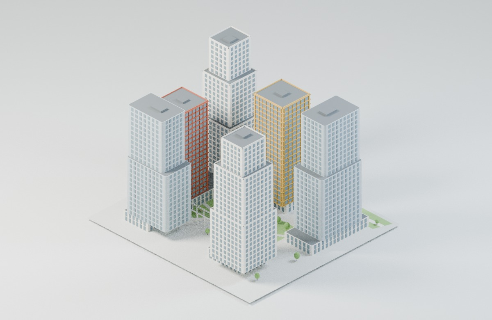
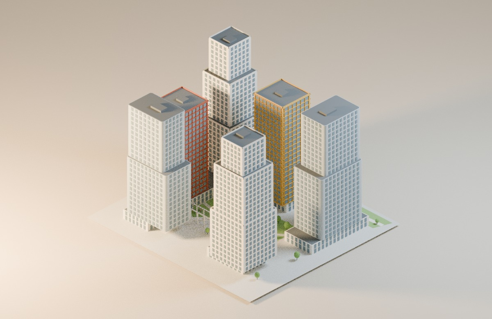
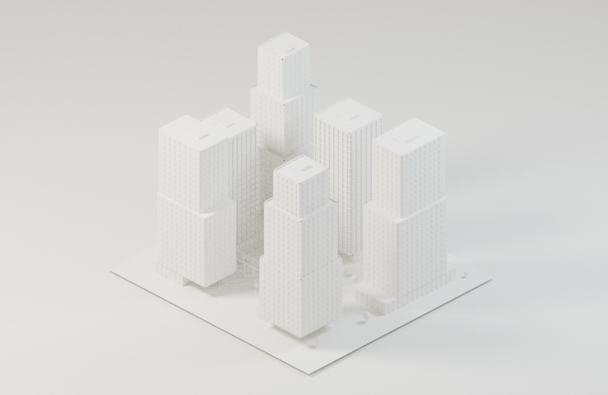
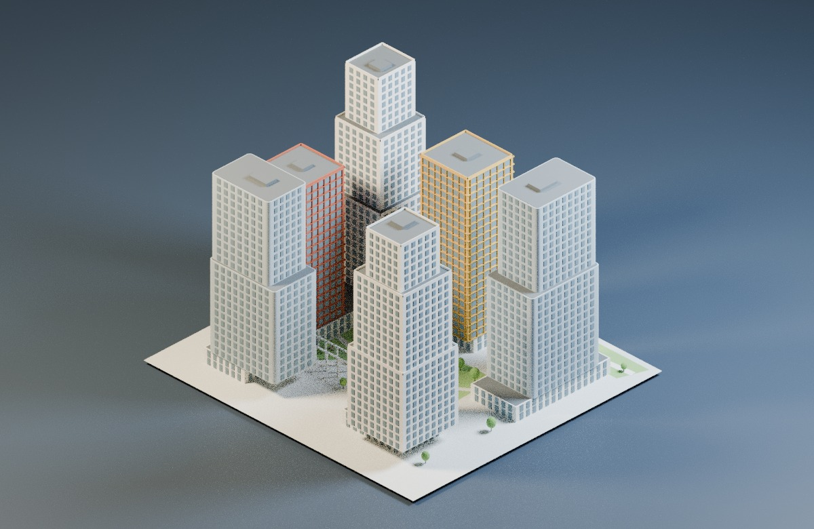
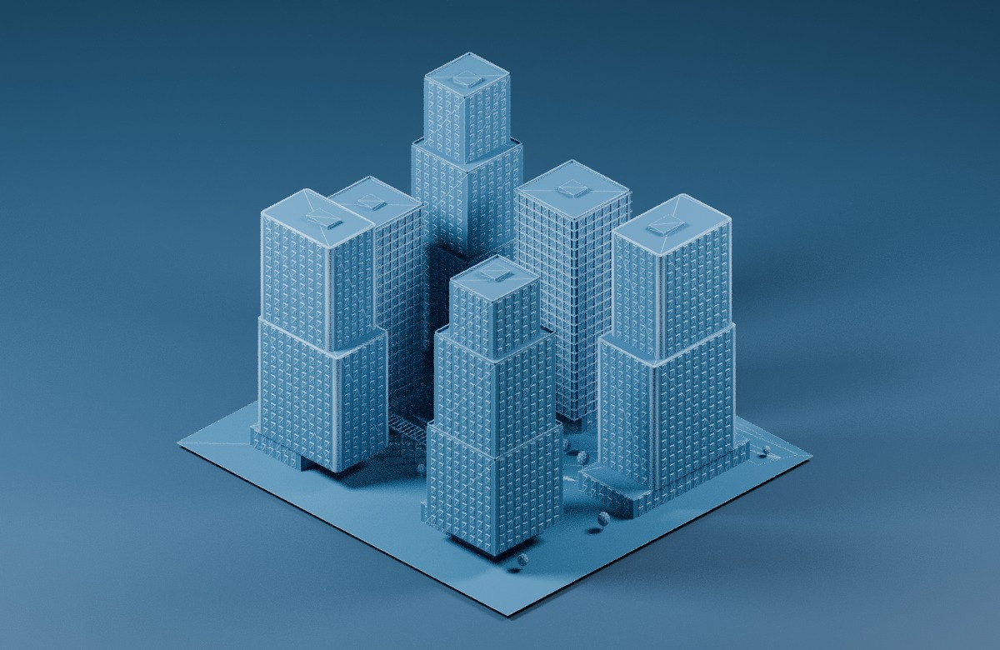

# ГРАНЬ — пять направлений визуализации

Концепции для выбора художественного направления. Основной сайт не изменён.
Рендеры выполнены в Blender Cycles из геометрии первого проекта, извлечённой из текущего index.html. Композиция зданий, камера и масштаб одинаковы во всех пяти вариантах. Это статичные концепт-рендеры, а не скриншоты WebGL и не обещание такого же качества в браузере без дополнительной работы.

## 01. Архитектурный день — рекомендуемый основной стиль

Нейтральный фон, естественные материалы и мягкие тени. Подходит для главного экрана, карточек проектов и калькулятора.

## 02. Золотой час

Тёплый направленный свет, длинные тени и атмосферная подача. Подходит для выразительной презентации проектов.

## 03. Белый архитектурный макет

Фарфоровая палитра, акцент на объёмах и пластике. Хорошо подходит для концепций и НПМ; скрывает различия исходных материалов.

## 04. Тёмная студия

Графитовая подложка и контровое освещение. Подходит для крупных презентаций; для мелких карточек потребуется отдельная проверка читаемости.

## 05. Инженерная схема

Синие объёмы и светлые контуры геометрии. Подходит как технический режим; фактические атрибуты IFC этим рендером не подтверждаются.

## Что предстоит после выбора

Перенести выбранную систему света, теней, материалов и фона в обе системы 3D сайта: главный макет и Viewer проектов/калькулятора. Сохранить различия НПМ, ВПМ и ЦИМ. Проверить все четыре проекта, смену режимов, вращение, масштабирование, адаптивность, производительность на мобильных устройствах и изображение в экспорте PDF.

Ограничения: WebGL контекст в браузере текущей среды не создаётся. Интерактивность, производительность и итоговый вид в Three.js не подтверждены. Эти варианты показывают направление работы; окончательное внедрение начнётся после выбора пользователя, публикация — только после отдельного разрешения.

Геометрия первого проекта на сайте является реконструкцией по изображениям с ориентировочными размерами. Рендеры не уточняют её до обмерной/BIM-модели.
