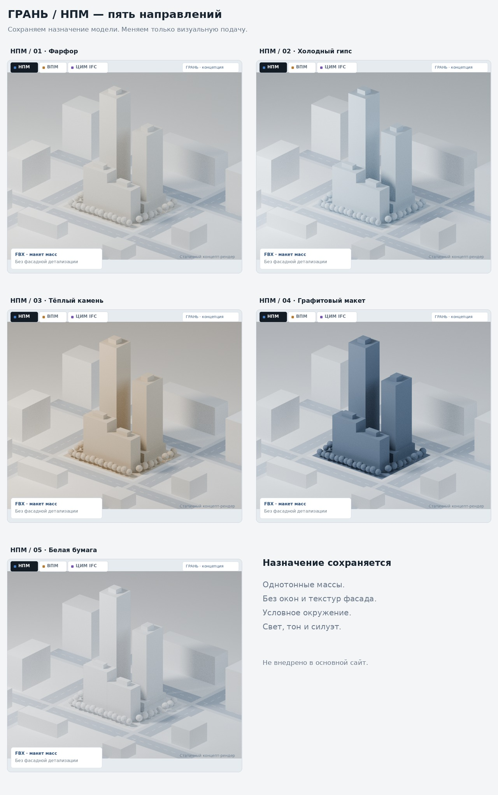
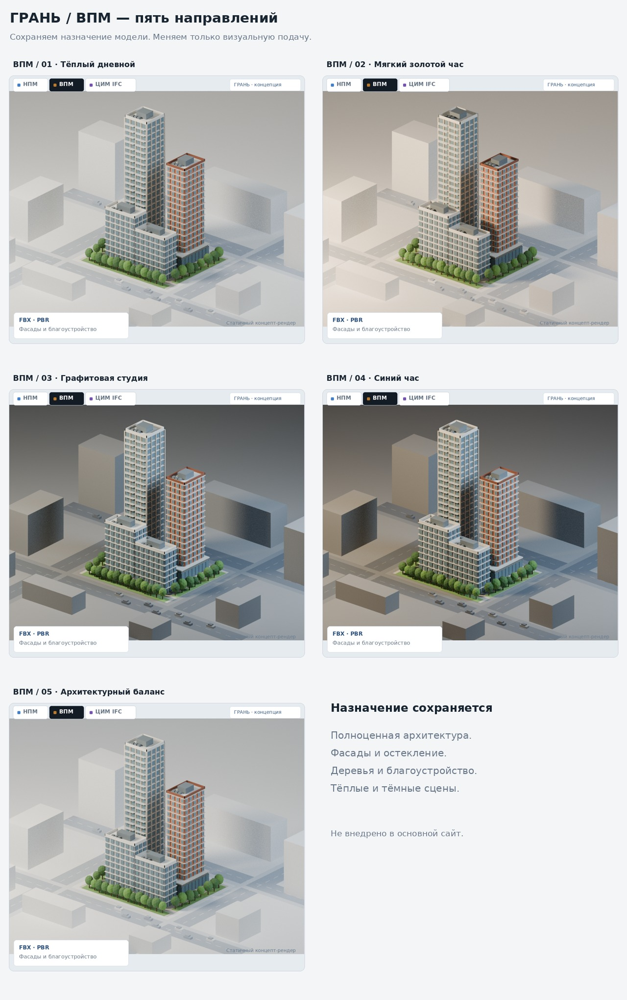
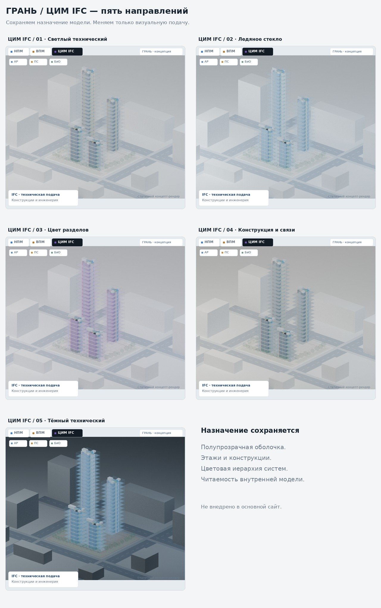

# ГРАНЬ — визуальная проработка НПМ, ВПМ и ЦИМ IFC

Пятнадцать направлений: по пять для каждого типа модели. Они сохраняют различия исходных режимов. Здесь показан главный макет с сайта — тот же комплекс, что на скриншотах пользователя. Камера и масштаб одинаковы; фасады и инженерия не добавляются в НПМ.

Это статичные рендеры Blender Cycles из фактической геометрии index.html, а не скриншоты браузера. Кадры дополнены обрамлением, легендой и панелями в стиле интерфейса ГРАНЬ. Изображённые панели служат только для оценки дизайна, не являются работающими элементами управления. Внутренняя геометрия ЦИМ взята из существующего heroBim/buildProject, а не выдумана для рендеров. Экспорт или валидность IFC по этим изображениям не подтверждаются.

## НПМ — пустые монотонные объёмы

Никаких окон, фасадных текстур, инженерии или дополнительного благоустройства. Только масса, силуэт и иерархия объекта/окружения. Условные деревья остаются того же монотонного материала.

1. **[Фарфор](views/npm-01.jpg)** — тёплый нейтральный материал, холодное окружение, мягкая контактная тень. Рекомендуемый основной вариант.
2. **[Холодный гипс](views/npm-02.jpg)** — монотонный серо-голубой макет; аккуратная связь с синим акцентом сайта.
3. **[Тёплый камень](views/npm-03.jpg)** — песочный однотонный материал, чуть более направленный свет. Самый спокойный тёплый вариант.
4. **[Графитовый макет](views/npm-04.jpg)** — тёмные однородные массы на светлом фоне. Контраст создаётся материалом, а не деталями.
5. **[Белая бумага](views/npm-05.jpg)** — светлые объёмы и тонкие контуры граней без рисунка фасада. Самая графичная подача.

## ВПМ — полноценная архитектура

Остаются фасады, остекление, кровли, деревья, благоустройство и автомобили. Развитие понравившихся пользователю тёплого и тёмного направлений; тёмная сцена остаётся внутри светлой карточки сайта.

1. **[Тёплый дневной](views/vpm-01.jpg)** — натуральные материалы, приглушённая зелень, мягкое солнце. Универсальный светлый вариант.
2. **[Мягкий золотой час](views/vpm-02.jpg)** — направленный тёплый свет, выраженные тени и более атмосферная подача.
3. **[Графитовая студия](views/vpm-03.jpg)** — графитовая сцена, тёплый основной свет, холодное заполнение. Контрастный презентационный вариант.
4. **[Синий час](views/vpm-04.jpg)** — более холодная тёмная сцена и тёплый свет на архитектуре. Стилизация освещения, без выдуманного света в окнах.
5. **[Архитектурный баланс](views/vpm-05.jpg)** — светлая холодная подложка, тёплая архитектура, спокойная насыщенность. Рекомендуемый вариант для общего стиля сайта.

## ЦИМ IFC — читаемая техническая модель

Полупрозрачность остаётся средством раскрытия структуры, а не декоративным стеклом. Этажи, ядра, лестницы и инженерные системы читаются отдельно; фон и окружение подчинены модели. Цвета инженерии сохраняют стабильные значения во всех пяти вариантах.

1. **[Светлый технический](views/cim-01.jpg)** — нейтральные конструкции, тонкий голубой контур, устойчивые цвета инженерии. Рекомендуемый основной вариант.
2. **[Ледяное стекло](views/cim-02.jpg)** — более холодная оболочка и лёгкие перекрытия; ощущение прозрачного технического макета.
3. **[Цвет разделов](views/cim-03.jpg)** — лёгкий фиолетовый тон архитектурной оболочки; оранжевый участок и зелёное благоустройство в легенде. Цвета систем не смешиваются с цветами разделов.
4. **[Конструкция и связи](views/cim-04.jpg)** — более плотные серые перекрытия, сдержанная оболочка; акцент на структуре и инженерных связях.
5. **[Тёмный технический](views/cim-05.jpg)** — тёмная сцена и светлые контуры внутри светлой карточки. Для отдельного режима презентации, с обязательной проверкой читаемости мелких элементов.

## Рекомендованный комплект

**НПМ 1 + ВПМ 2 + ЦИМ 1** — единый светлый интерфейс с ясным различием типов моделей. Альтернатива с тёмной ВПМ: НПМ 1 + ВПМ 3 + ЦИМ 1. Более нейтральная ВПМ — вариант 5. Стили выбираются отдельно для каждого типа, а не навязываются сразу всем режимам.

## Проверки, ограничения и дальнейшая работа

- Геометрия взята из текущего main `cf9cebb291ff7ce8c782aad9c28b7c608408b4f7`; НПМ, ВПМ и ЦИМ экспортированы раздельно. Основной сайт и main не изменяются.
- Рендеры служат выбору направления света, материалов, теней, контуров и визуальной иерархии. Они не означают, что Blender-качество уже перенесено в Three.js.
- В предыдущей проверке браузер среды возвращал `Error creating WebGL context`. Живое вращение, наведение, выбор этажей, управление разделами, работа на телефонах и FPS не подтверждены этими рендерами.
- После выбора: внедрить стили в обе системы 3D, сохранить семантику режимов, проверить все четыре проекта, главный макет, калькулятор и снимок для PDF, провести проверку адаптивности и производительности. Публиковать только после отдельного разрешения на показанную проверенную версию.
- Совпадающие плоскости пересечений дорог объединены только в рендерах с сохранением их площади, чтобы убрать чёрные артефакты. Геометрия зданий не изменена.
- Изменение геометрии, LOD и числа треугольников не входит в этот этап; визуальные контуры и тени не превращают НПМ в ВПМ.

Исходники генерации: `source/export.cjs` и `source/render.py`. Экспорт запускается из корня репозитория в Node.js с зависимостью `three@0.128.0`, затем рендер — в Blender 4.3.2. Промежуточные JSON/PNG пишутся в work/mode-study; рабочий сайт эти скрипты не использует.
