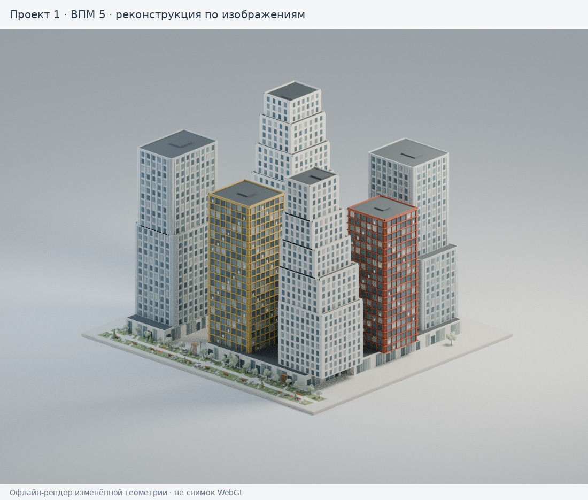
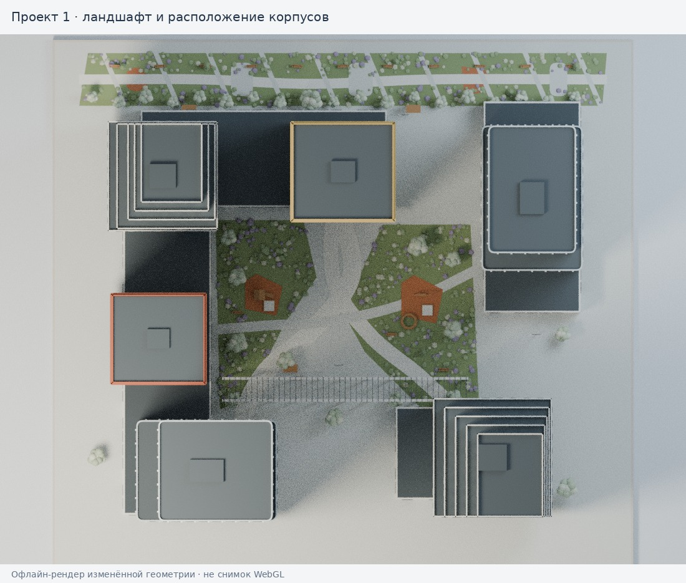
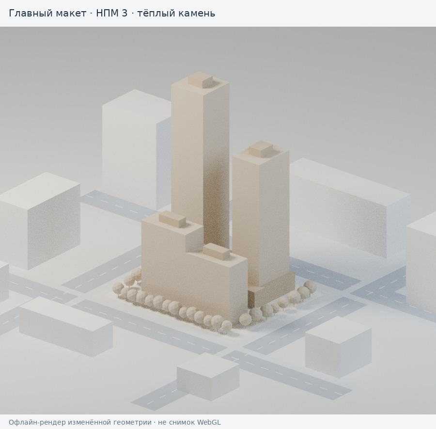
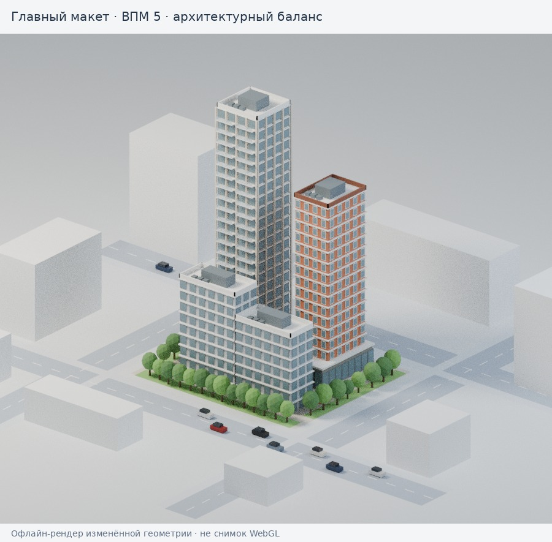
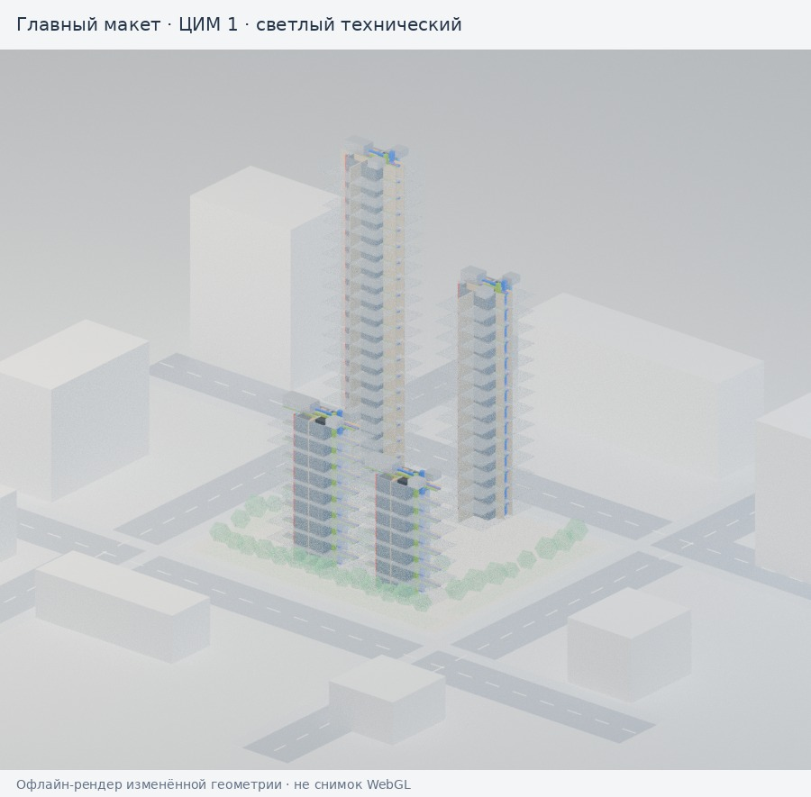
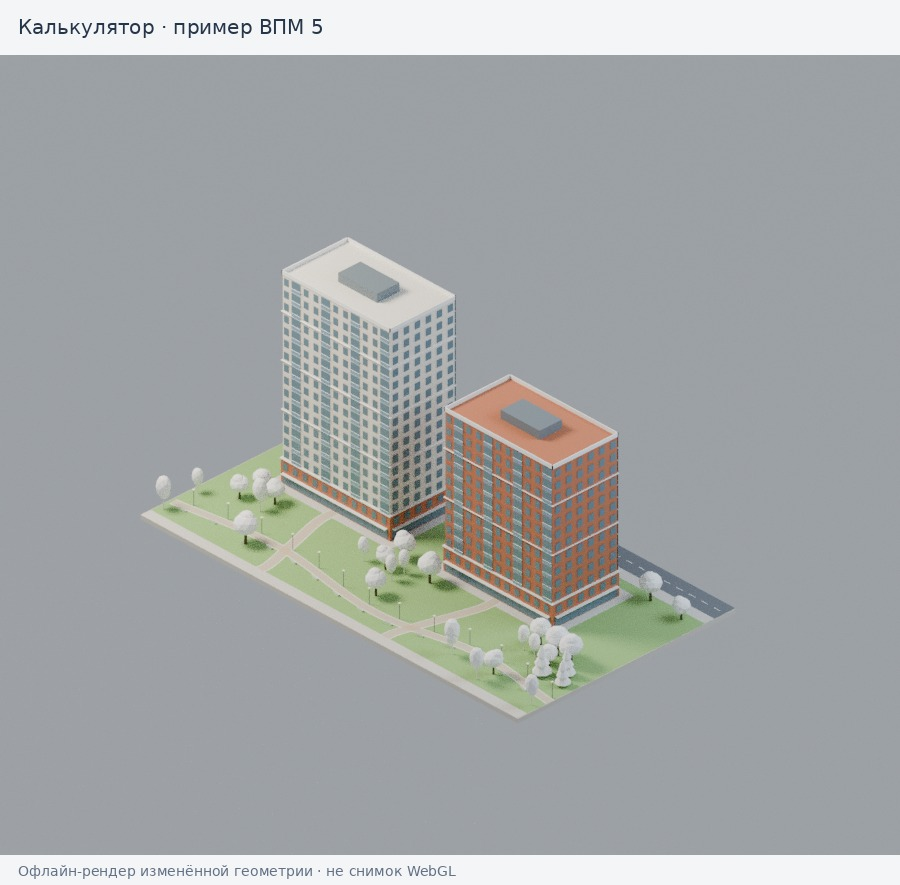

# Реализация утверждённых стилей ГРАНЬ

Изменения подготовлены в `feat/approved-3d-styles`, без слияния в main и без публикации.

## Что реализовано

- Все четыре проекта в карточках и модальном просмотрщике показываются только в ВПМ; переключатели НПМ/ЦИМ в проектах удалены. Вращение, масштабирование и ракурсы сохраняются.
- Главный макет и калькулятор: НПМ 3 «Тёплый камень», ВПМ 5 «Архитектурный баланс», ЦИМ 1 «Светлый технический».
- Общее освещение для обеих систем просмотра. Материалы стекла с локально генерируемым окружением отражений, мягкие кэшируемые тени для НПМ/ВПМ. ЦИМ остаётся технической полупрозрачной моделью с цветами инженерных систем.
- Ограничены разрешения рендера и теней для маленьких экранов и карточек. Карты теней не пересчитываются при каждом повороте камеры.
- Проект 1 переработан по предоставленным ракурсам: шесть корпусов, ступенчатые белые объёмы, серые фасады с вертикальными рёбрами и скруглениями, золотой и терракотовый каркасы, стилобат с витринами, колоннада/пергола, два двора и уличный сад, диагональные маршруты, игровые площадки, павильоны, лавки, светильники и смешанные посадки.

## Проект 1: вид и план

**Это реконструкция по изображениям с ориентировочными размерами. Точность «1 в 1» не достигнута и не подтверждена.** Для неё нужны исходная FBX/GLB/IFC-модель или размерные планы/фасады. Недоступные по фотографиям детали не выдаются за достоверные.

Изображения ниже — офлайн-рендеры фактической геометрии и палитры изменённого кода. Это не снимки браузера: Blender и Three.js по-разному рассчитывают освещение, прозрачность и отражения. Изображения позволяют проверить композицию и состав модели, но не заменяют живой просмотр WebGL.

## Главный макет

## Калькулятор

## Что проверено

`npm ci --ignore-scripts && npm test` выполняет проверки:

- Геометрия всех четырёх проектов, конечные координаты вершин и инстансов; ограничение сложности проекта 1.
- НПМ сохраняет монотонную палитру без фасадной геометрии; ЦИМ и ВПМ используют свои режимы освещения и теней.
- Площадь объединённых дорог сохранена, совпадающие плоскости на перекрёстках удалены.
- Построение, смена режимов и видимость групп калькулятора; проектный просмотрщик не переключается из ВПМ в НПМ/ЦИМ.
- Выбор корпуса ЦИМ настоящим Three.js Raycaster с отображением атрибутов — без GPU, с заменой только WebGLRenderer тестовым адаптером.
- DOM-навигация, открытие/закрытие проекта, калькулятор при площадях 200 / 12 000 / 45 000 / 400 000 м², пустом выборе и выборе только ЦИМ.
- Работа страницы при недоступных Three.js и WebGL. Формулы расчёта стоимости не изменялись.

Добавлена GitHub Actions-проверка для PR. Она запускает тесты и не содержит публикации или развёртывания.

## Что проверить пока невозможно

Браузерный инструмент текущей среды возвращает `Browser Use could not read requirements`; Chromium не предоставил доступного окна. Ранее в этой среде WebGL также возвращал `Error creating WebGL context`. Поэтому живая отрисовка Three.js, вращение мышью/пальцем, GPU/FPS, мобильная адаптивность и визуальный результат PDF **не подтверждены**. DOM- и CPU-проверки не заменяют эти проверки. Нужен просмотр на устройстве с работающим WebGL до окончательного решения о выпуске.

Согласование визуального направления не считается разрешением на публикацию. Публиковать только после отдельного разрешения на конкретный SHA из PR.
