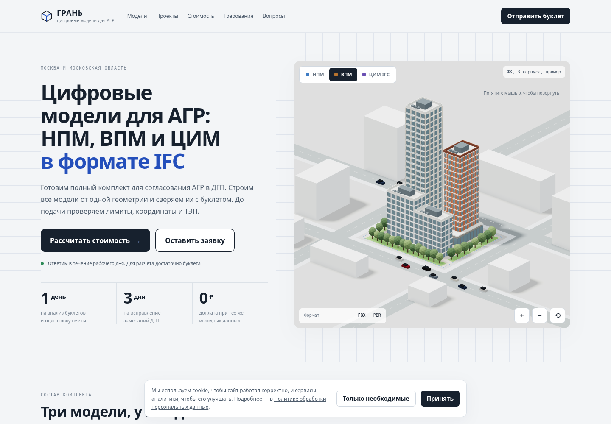
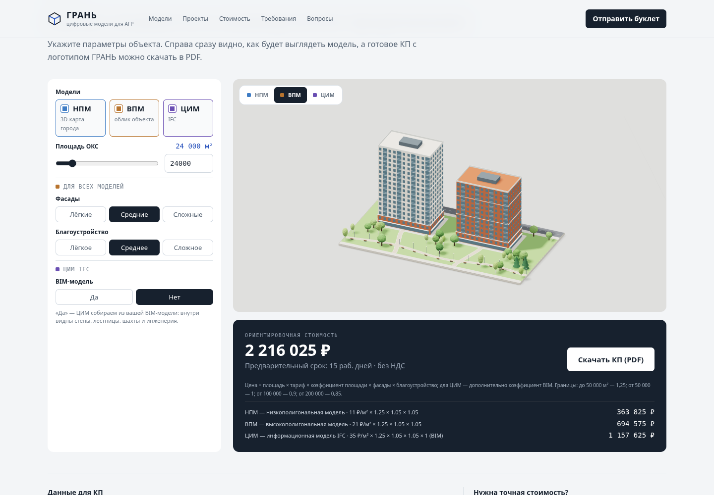
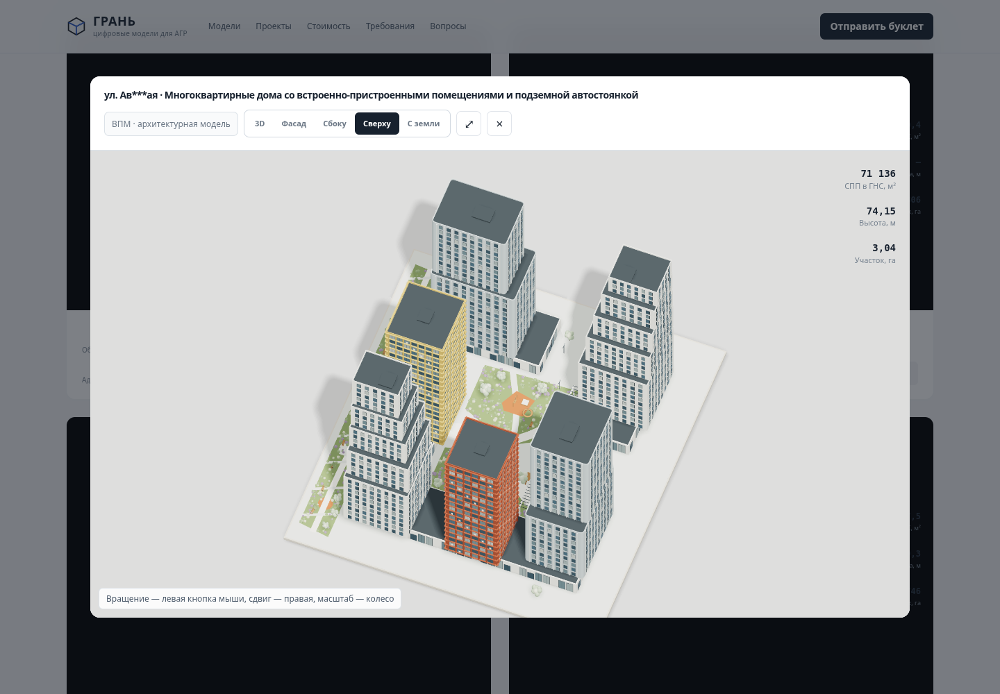
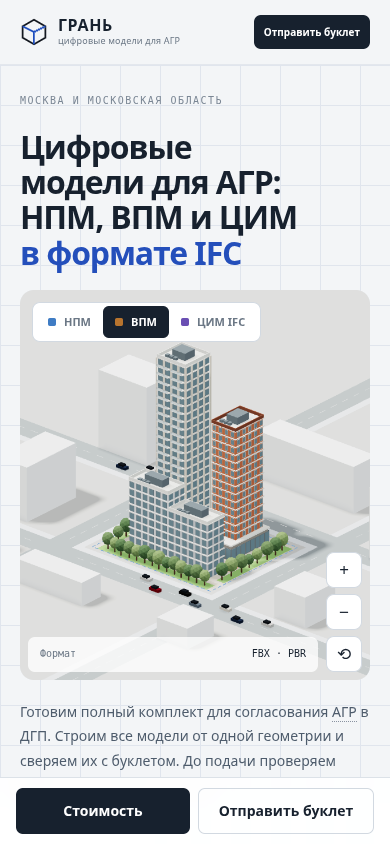
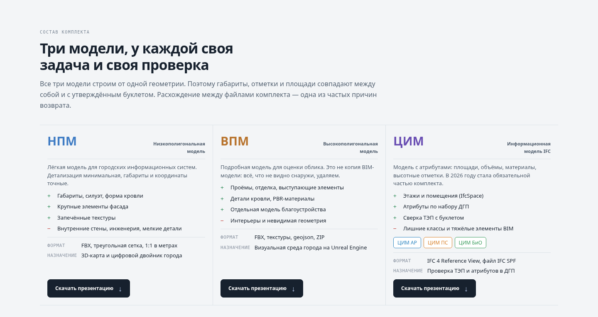
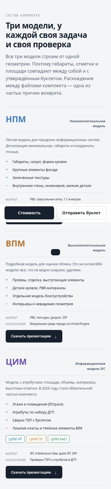

# Проверка скорости перед запуском

База: `2a11a20dae7e4372be93303bfb8cd56b66164fcb`.
Публикация не разрешена. Сервер, заявки, контакты и домен отложены по указанию пользователя.

## Изменения

- Three.js r128 и OrbitControls сохранены локально с лицензией: нет зависимости 3D от двух CDN.
- WebGL калькулятора создаётся при приближении к блоку (180 px), расчёт стоимости работает сразу.
- Отрисовка ограничена 30 кадрами/с; скорость вращения и анимаций рассчитывается по прошедшему времени.
- Геометрия, материалы, освещение, CSS и сетка не менялись.

## Измерение

Chromium 156, 1440×1000, SwiftShader (программная графика), localhost. Один контрольный запуск до/после; показатели не являются полевыми Core Web Vitals и не доказывают прирост GPU FPS. Шрифты отключены для одинаковых условий, исходные CDN-скрипты подменены теми же локальными r128. Поэтому сетевую экономию этот замер не оценивает. LCP не получен; публичная загрузка в мобильной сети требует отдельной проверки перед выпуском.

| Метрика | До | После |
|---|---:|---:|
| DOMContentLoaded | 4255 мс | 3450 мс |
| Длительность длинных задач при старте | 3879 мс | 2828 мс |
| Canvas при старте | 2 | 1 |
| Максимум треугольников в кадре | 30732 | 30732 |

Замеры с программной графикой сильно зависят от среды; вывод — уменьшена стартовая работа, реальный FPS на устройстве пользователя пока не подтверждён.

## Проверки

`npm ci --cache work/npm-cache --no-audit --no-fund`, `npm test` — PASS: тарифы, геометрия, DOM, отсутствие WebGL, режимы моделей, отложенное создание сцен, выбор IFC, остановка фона в модальном окне. Допуск теста вращения учитывает остаток времени между кадрами при ограничении 30 FPS.

Скриншоты получены браузерным Three.js. Использованы системные шрифты из-за отключения внешней загрузки в контрольном тесте.

## До полноценного запуска

Форма по-прежнему демонстрационная: показывает успех без отправки. Контакты и реквизиты требуют замены. Эти части не включены в текущую версию по уточнённому приоритету пользователя. Перед запуском подключить серверное сохранение, уведомления, реальные согласия и проверить доставку. Никаких изменений публикации и main.

Браузерная проверка Chromium: переключение трёх режимов калькулятора, открытие проекта, вид сверху, закрытие и переход к ширине 390 px — без ошибок JS, горизонтального переполнения нет. PDF не проверен в этом проходе.

Скриншоты сняты с кода `9993698` (следующий коммит добавляет только отчёт и изображения).

## Уточнения оформления

Удалён вводный абзац проектов без замены. Во всех четырёх адресах ровно четыре звёздочки. Кнопки презентаций получили графитовый фон, белый текст, стрелку скачивания и высоту 44 px; состояния наведения и клавиатурного фокуса различимы. Сетка сохранена.

Проверено: DOM-тесты с WebGL и без него, наличие всех трёх PDF (HTTP 200), количество звёздочек; Chromium 1440 px и 390 px, переполнения нет. Снимки блока без загрузки 3D и внешних шрифтов, к которым эти правки не относятся.

