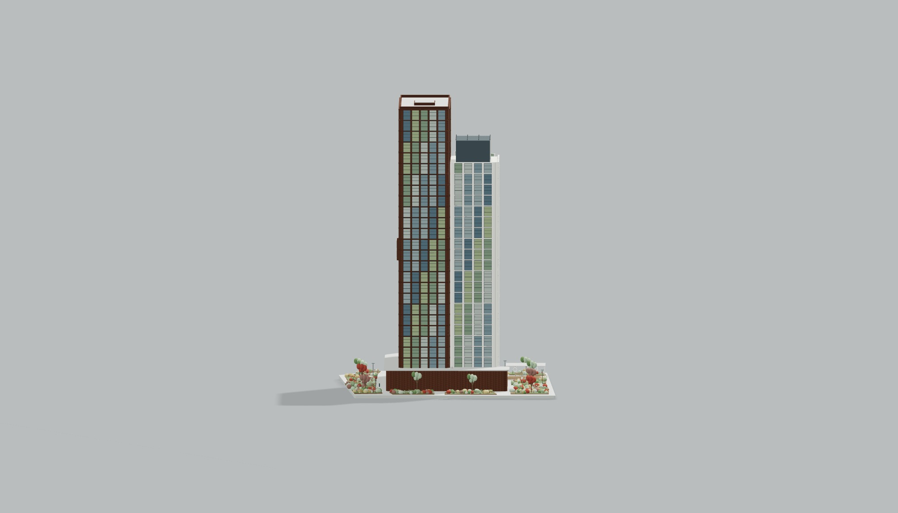

# Маски названий и минимальная площадь

Вместо полей «Адрес объекта / Застройщик — NDA» в карточках:
1. Объект: Ав******ая
2. Объект: Баб*****ая
3. Объект: Авто*****ая
4. Объект: Ряб*****ая

Количество звёзд сохранено из текста пользователя после снятия Markdown-выделения. Звёзды выводятся как обычный текст.

Минимальная площадь калькулятора изменена с 200 до 5000 м²: HTML min, предел числового ввода и логарифмическая шкала ползунка. В крайнем левом положении — 5000 м², справа — прежние 400000 м². Значения ниже минимума при подтверждении ввода приводятся к 5000. Стартовое значение 24000 м² сохранено. Тарифы, коэффициенты и округление не изменены.

npm test и git diff --check прошли. DOM-тесты проверяют все четыре маски, отсутствие NDA в карточках, нижнюю границу числового поля и обе крайние точки ползунка. Публикация не выполнялась.

## Единый фон ВПМ

Фон главного макета ВПМ приведён к тому же цвету #B9BDBD из общего пресета, который используют проекты. Освещаемая плоскость раньше выглядела светлее плоского фона карточек; теперь цвет фона не зависит от экспозиции, а тени сохраняются отдельным принимающим слоем. Фоновые корпуса, дороги, автомобили, деревья, геометрия и интерактивность не удалены. НПМ и ЦИМ сохраняют свою прежнюю палитру. Тесты проверяют точный цвет фона ВПМ, приём теней и наличие фоновых корпусов.

## Второй проект по семи фотографиям

Вместо прежней условной округлой башни собран отдельный детальный объект: высокая коричневая кирпичная часть, более низкая белая часть со скошенным завершением, многослойные оконные порталы, вертикальные простенки и витражные выступы, тёмные ребристые экраны на кровле, парапеты, кирпичный стилобат с закруглениями. На участке — угловатые посадочные островки, смешанные травы и кустарники, зелёные и осенние деревья, мощение, пергола с двумя подвесными кольцами, скамьи и освещение.

Модель содержит 232524 треугольника и 73 меша, повторяющиеся детали объединены через InstancedMesh. Это реконструкция по ракурсам: размеры и невидимые на фото стороны ориентировочные. Исходной BIM-модели или обмеров нет. Проверки подтверждают конечные координаты, наличие детализации, два подвесных кольца и режим ВПМ. Другие проекты не заменены.

## Браузерная проверка

Локальная копия страницы проверена в Chromium с обычным ANGLE SwiftShader. Для автономного просмотра Three.js и OrbitControls подставлены из node_modules; PDF-библиотека исключена только из локального стенда. В исходной странице CDN-ссылки сохранены. Проверены главный ВПМ с сохранённым окружением, карточки с масками названий, открытие второго проекта, объёмный и фасадный ракурсы. Снимок `project-2.jpg` получен непосредственно `Viewer.snapshot()` реального Three.js-рендерера. Частота 120 FPS на пользовательском устройстве этим просмотром не подтверждается; текущая задача не меняет цикл вращения. Полный `npm test` и `git diff --check` прошли после итоговых изменений.

