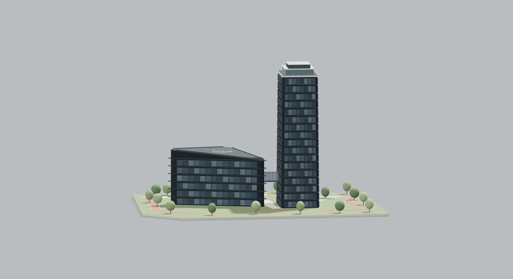
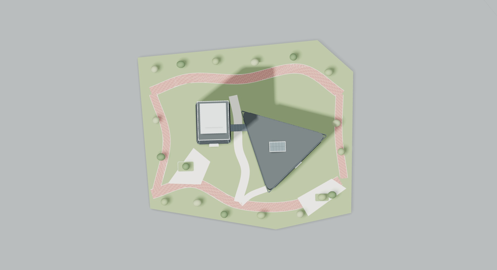

# Уточнение «Рябиновой»: переход, кровли, благоустройство

Повторно осмотрена только исходная гостевая ссылка пользователя через TinyFish, с приближением и сменой ракурсов. Сетевые файлы и исходная геометрия не получены. Отчёт осмотра: https://agent.tinyfish.ai/runs/b26a3db4-01a8-4362-8ddd-c098c6407a4f . Сам отчёт не заменяет размерные чертежи и не подтверждает точность реконструкции.

Выявленная ошибка предыдущей версии: наземный соединительный вестибюль. По повторному осмотру связь приподнята над землёй, остеклена и имеет открытое пространство снизу, без видимых опор. В новой версии наземный объём удалён; выполнены настил, прозрачные боковые и верхние панели, переплёты, примыкания к корпусам. Высотное положение в районе 3–5-го этажа — оценка по виду, не измерение. В коде принят просвет 10,2 условной единицы.

Уточнены: лёгкое сужение башни, многослойная корона с остеклением, наклонная треугольная кровля низкого корпуса вместо плоской. Оценка этажности после повторного осмотра 15–18 и 5–7; рабочая реконструкция использует 17 и 6. Уменьшение числа этажных рядов вызвано оценкой пропорций, не упрощением окон: объёмные рамы/откосы/переплёты сохранены.

Ландшафт: расширены мощёные входные участки и проход под переходом; добавлены отдельные прямоугольные элементы мощения, ступени, низкие борта посадочных островков и внутренняя растительность. Сохранены криволинейные красноватые дорожки. Точные координаты островков, ступеней и деревьев не подтверждены — это интерпретация видимых признаков, а не установленный генплан. Парковка и подземные сооружения не выдумываются по неопределённым краям модели.

Итоговая детализация: 134 205 треугольников, 41 mesh-объект. Инстансы сохраняют детали; децимация/LOD не применялись. Тесты проверяют геометрию, просвет под переходом, отсутствие опор, наклонную кровлю, мощение и посадочные островки; прежние проверки сайта проходят.

До согласования эта версия не публикуется. Максимальное визуальное соответствие остаётся ограничено отсутствием исходных размеров и непосредственно доступных референсных кадров; точность «1 в 1» не заявляется.

## Реальные кадры Three.js

Кадры получены из WebGL-буфера того же Three.js в Chromium ANGLE SwiftShader. Это проверка видимости и геометрии новой версии, а не подтверждение точного совпадения со всеми частями исходника.
