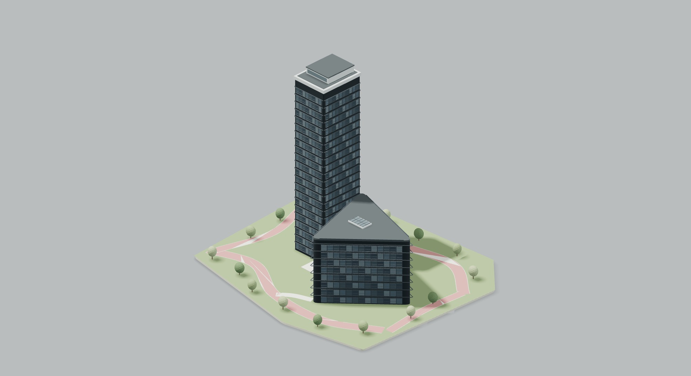

# Проект 4 — «Рябиновая», первый вариант

Источник: https://cimcheck.mos.ru/project/guest/a435d5c7-387e-42d1-99f0-637ddbe9d289

Пользователь разрешил приблизительную реконструкцию после проверки, что исходную геометрию получить текущими инструментами не удалось. Это новая процедурная ВПМ, а не импорт модели и не точная копия.

Гостевой вид через TinyFish показывает статус 1/3 загруженных моделей. Наблюдения: два связанных объёма; высокая тёмная прямоугольная башня со ступенчатым светлым завершением; низкий широкий клиновидный корпус со скруглёнными углами и кровельным элементом; регулярная сетка остекления без видимых балконов; зелёные участки и розоватые извилистые пешеходные дорожки. Соотношение высот оценивается примерно как 2,5–3:1. Полных размеров, этажности, планов и скрытых фасадов нет.

Воссозданы эти основные признаки. Материалы, растительность, свет и интерактивное управление соответствуют стилю ГРАНЬ. Старые неподтверждённые данные карточки (49 670 м², 74 м, 3,04 га) удалены, проект явно помечен реконструкцией.

Размеры, число этажей, ритм скрытых фасадов, положение дорожек/насаждений и детали входа — рабочие предположения. Две незагрузившиеся части не восстановлены достоверно. Нельзя считать модель обмерной, IFC-моделью исходного проекта или подтверждённой копией 1 в 1.

По уточнению пользователя детализация не сокращается: отдельная геометрия алюминиевых рам, откосов, подоконников и переплётов каждого окна, входного портала, ручек дверей, парапетов, кровельного остекления и бордюров. Кроны деревьев повышенной детализации. Инстансирование сохраняет все эти элементы и не является упрощением формы. Тесты проверяют валидность геометрии, ВПМ-only режим, два основных объёма, наличие клиновидного корпуса и явную отметку приблизительности. Остальные три проекта, режимы главного макета и калькулятор не изменены.

Изменение подготовлено в рабочей ветке и PR без публикации.

## Реальный результат

Кадр получен из реального WebGL Chromium ANGLE SwiftShader тем же рендерером сайта. Проверены карточка №4 и большой просмотр; модель содержит 104 186 треугольников и 27 mesh-объектов. Все npm-тесты и git diff --check прошли. Аппаратный FPS и совпадение с незагрузившимися частями источника не подтверждены.
