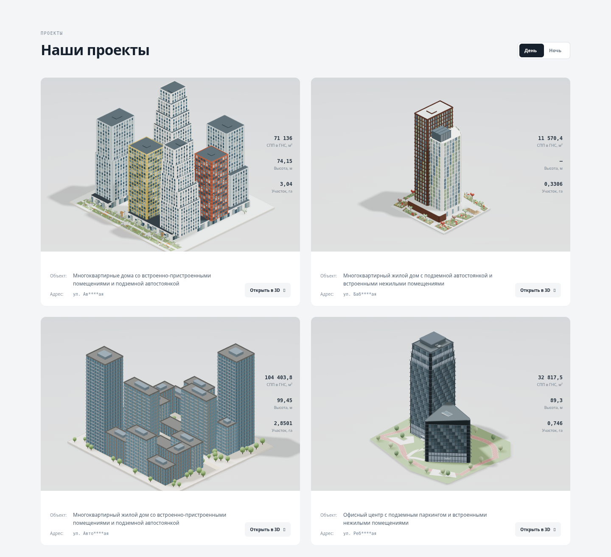
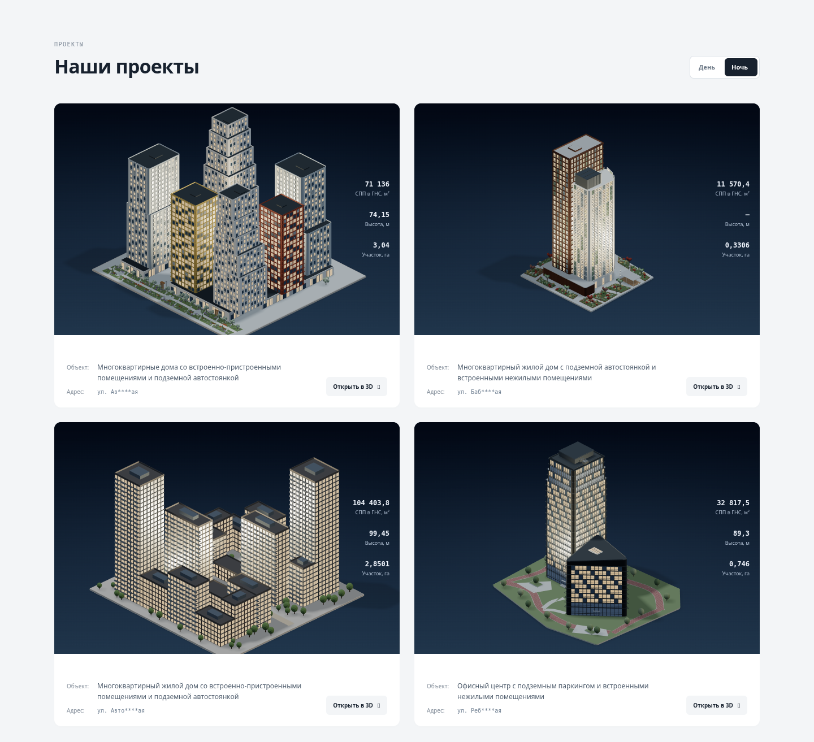
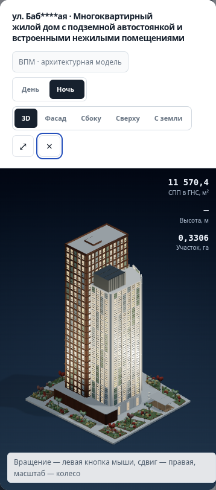

# Мягкий архитектурный свет — выбранный вариант 02

База: опубликованный main 16ad3ed7fff69ab0bb529692248e6e54fc17f4fc. Материалы сравнения Blender/Babylon в эту ветку не включены.

## Реализация

- Проекты и проектный просмотрщик используют выбранную подачу Three.js: светлый дневной градиент, графитово-синий ночной фон, мягкие тени, тёплое свечение стекла и два прожектора без карт теней.
- Ручные кнопки «День / Ночь» над сеткой и в просмотрщике синхронизированы. По умолчанию день; выбранный режим сохраняется при открытии другого проекта и отложенной загрузке карточек.
- Освещение не меняет геометрию, ракурс или zoom. Сетка, содержание и режим ВПМ сохранены.
- Главный макет и калькулятор сохраняют свои прежние НПМ/ВПМ/ЦИМ. Материалы стекла проекта клонируются, чтобы ночь не влияла на общие материалы калькулятора; клоны освобождаются при замене проекта.
- Подсветка подстроена под габариты каждого из четырёх проектов. Окна светятся по группам исходных материалов, это архитектурная подача, не имитация реальной заселённости. При единственном общем материале стекла он становится тёплым целиком.
- Два фона 256×512 переиспользуются всеми сценами. Прожекторы скрыты днём и не создают дополнительных shadow maps ночью. Переключение не пересобирает модель; offscreen-пауза и лимит 30 FPS сохранены.
- Включено ранее запрошенное небольшое усиление разделителей блока комплекта (#bdc8d5) без изменения толщины и сетки.

## Проверки

`npm test` — PASS (тарифы, геометрия, DOM/навигация/калькулятор, fallback без WebGL, CPU-проверки сцен). Дополненные scene-тесты проверяют:

- день/ночь всех четырёх проектов;
- синхронизацию кнопок и наследование ночи карточками при ленивой загрузке;
- неизменность геометрии, камеры и zoom при переключении;
- переиспользование фоновой текстуры;
- отсутствие влияния на общие материалы калькулятора;
- отсутствие дополнительных теневых источников.

После финальной оптимизации visible прожекторов повторены проверки сцен и браузерная проверка.

Chromium / SwiftShader, desktop 1440 px: все четыре модели × два режима, без JS/shader ошибок. При 390×844 проверены ночная модель, отсутствие горизонтального переполнения, закрытие Escape. Карточки дополнительно отрисованы в обоих режимах. Изображения — реальные скриншоты текущего Three.js сайта, не концепции и не Blender.

Внешние шрифты отключены в среде проверки, используются системные; это ограничение снимков. Автоматическая анимация контролировалась вручную для захвата фиксированных ракурсов. Реальный GPU FPS, полевые Core Web Vitals и физические мобильные устройства не измерялись. Сервер заявок и домен остаются отложенными.

## Скриншоты

Каждый проект также снят отдельно: `project-1-day.png` / `project-1-night.png` … `project-4-day.png` / `project-4-night.png`.

## Воспроизведение

Из корня репозитория запустить `python3 -m http.server 8010 --bind 127.0.0.1`, затем `node review/soft-project-lighting/browser.cjs` (нужны Playwright и Chromium `/usr/bin/chromium`). Скрипт управляет requestAnimationFrame для стабильного захвата; production-код анимации не подменён.

Публикация и слияние не выполнялись. Версия предназначена для финального согласования.
