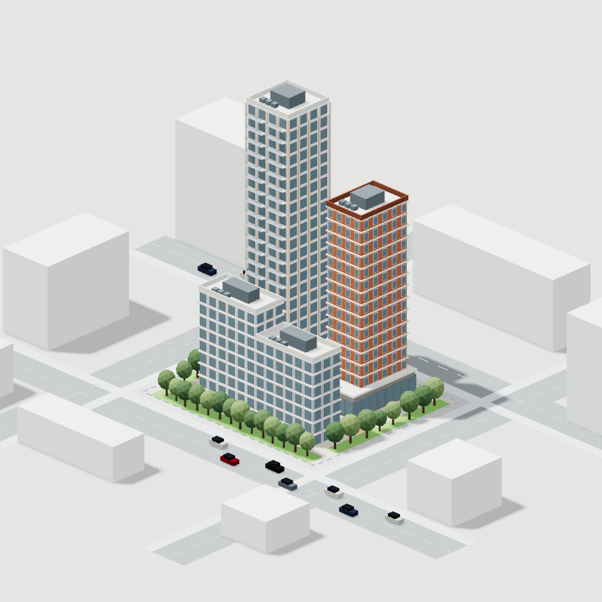

# Студийный свет и медленное вращение

Реальный WebGL-кадр Chromium / ANGLE SwiftShader. Фон ВПМ нейтральный серый, свет теплее, тени фасадов выразительнее, озеленение приглушено. НПМ и ЦИМ сохраняют свою палитру. Требуется визуальная оценка пользователем; точное совпадение с концепцией не заявляется.

Автовращение включено у главного макета, карточек, калькулятора и большого просмотра; после ручного вращения выдерживается пауза. Движение рассчитано по времени, а не числу кадров. Невидимые сцены не отрисовываются, карты теней кэшируются. Максимальный pixel ratio снижен с 2.25 до 1.75 (около 40% меньше пикселей при прежнем верхнем значении), мобильный — с 1.75 до 1.5. Частота requestAnimationFrame не ограничена искусственно.

npm test и git diff --check проходят. Добавлена проверка одинакового угла поворота за секунду при шагах 60 и 120 Гц; это не измерение FPS. Фактические 120 FPS не подтверждены: доступный WebGL работает программно, аппаратного стенда 120 Гц нет. На дисплее 60 Гц браузер обычно выдаёт не более 60 видимых кадров/с. Не обещать минимум 120 FPS на любых устройствах.

Публичный сайт не изменён. Новая версия подготовлена для отдельного согласования.
