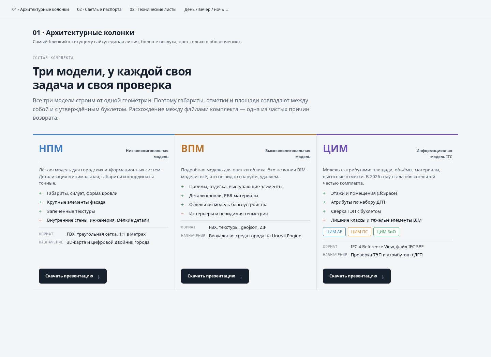
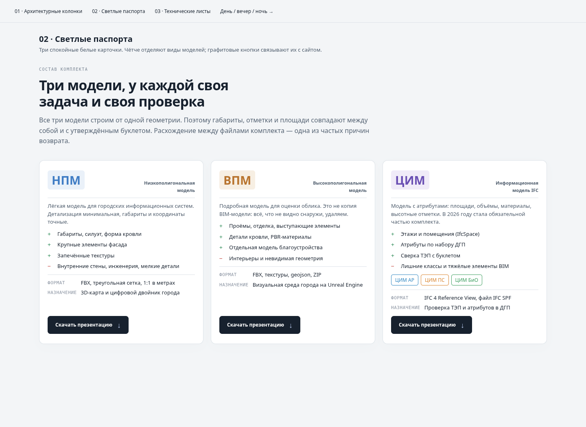
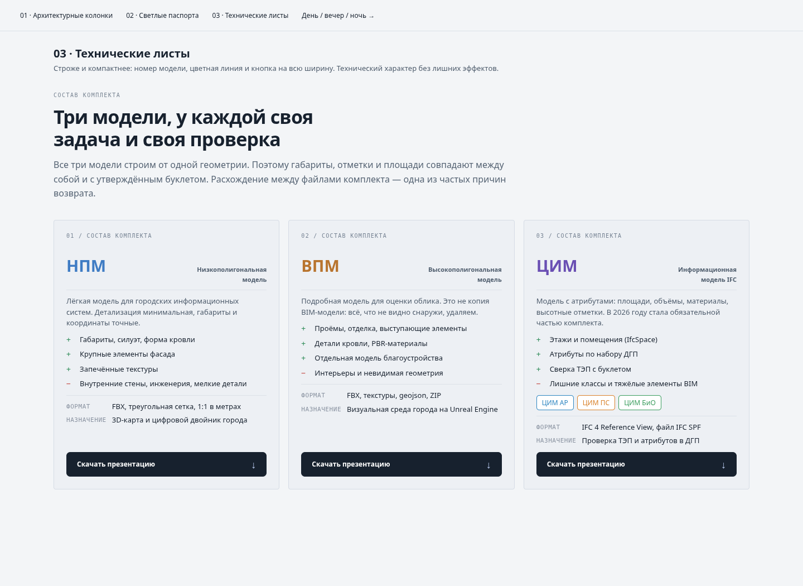
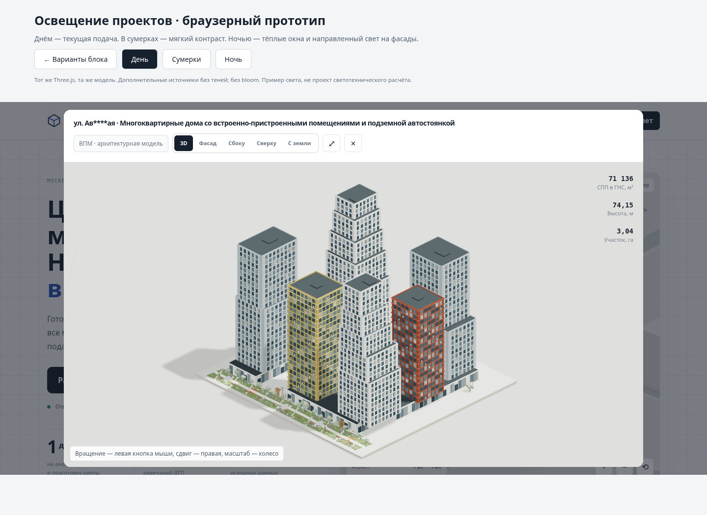
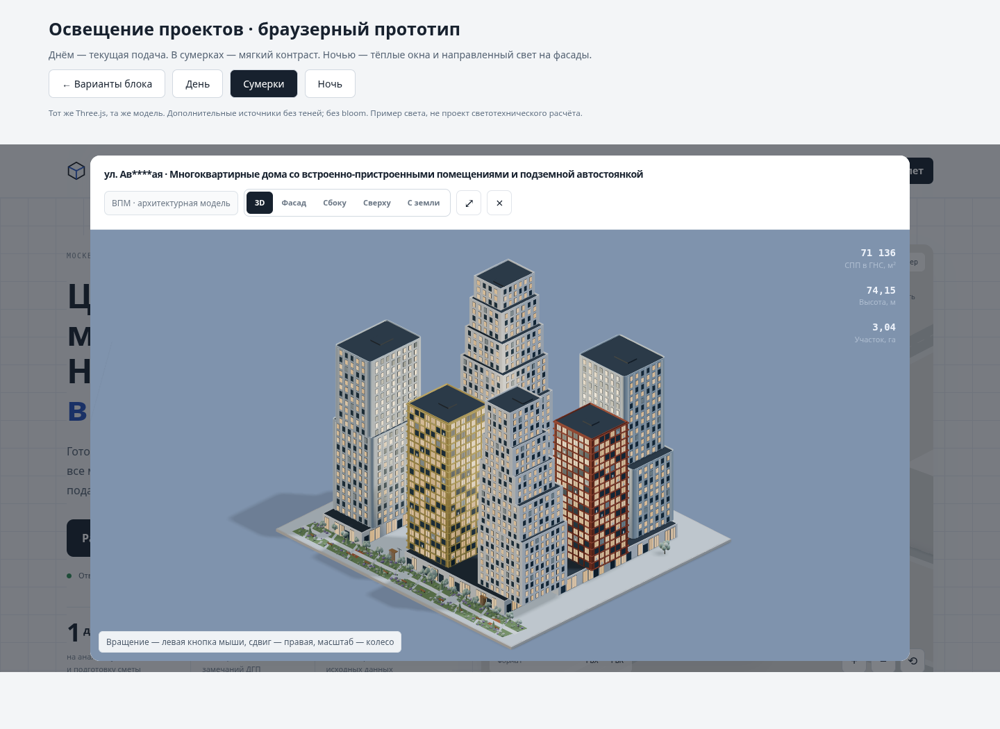
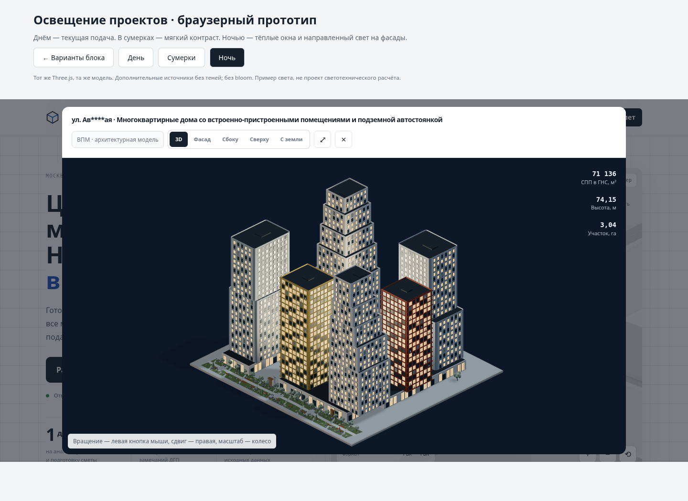

# Варианты оформления и освещения — только для согласования

База: 16ad3ed7fff69ab0bb529692248e6e54fc17f4fc. Рабочий сайт не менялся.

Открыть локально через HTTP: `/review/visual-options/compare.html`.

## Блок моделей

1. Архитектурные колонки: текущая компоновка, цветная верхняя линия, сдержанное оформление.
2. Светлые паспорта (рекомендуется): белые карточки с тонкой рамкой и лёгкими цветовыми подложками у НПМ/ВПМ/ЦИМ.
3. Технические листы: серые панели, номера 01–03, широкие кнопки.

Все три сохраняют содержание и три колонки на широком экране; мобильная версия — одна колонка.

## Свет

`lighting.html` открывает настоящий проект в iframe, затем применяет прототип к существующему Viewer и Three.js r128. В production JS/CSS изменения не внесены.

- День — существующая палитра и освещение.
- Сумерки — синий фон, мягкий свет и тёплые окна.
- Ночь — графитово-синий фон, холодное окружение, тёплые группы окон, два направленных прожектора на фасады без дополнительных карт теней.

Переключение не перестраивает модель. Без bloom и десятков динамических источников. Emissive-материал окон визуально светится, но не освещает окружение; фасады освещают два SpotLight. В прототипе распределение горящих окон привязано к общим материалам; для финального естественного рисунка стоит использовать маску по окнам/инстансам. Проверено на первом проекте; остальные три потребуют настройки расположения прожекторов по габаритам и проверки отдельно.

Предпочтительный интерфейс: ручной переключатель «День / Ночь», день по умолчанию; сумерки — опциональный третий режим. Автоматический режим можно добавить, но время посетителя не определяет его желание рассмотреть модель.

## Дальнейшая скорость — предложения, ещё не внедрены

1. Заменить четыре вращающихся карточки проектов на WebP/AVIF-рендеры. Один общий интерактивный Viewer открывается по клику. Это исключит четыре WebGL-контекста и постоянную отрисовку превью, сохранив их вид и размеры. При переключении дня/ночи — две готовые картинки на карточку.
2. Загружать Three.js и геометрию проектов через отдельные модули только при необходимости. Первый экран сразу показывает готовый рендер, интерактивность подключается позже. Нужен понятный переход без скачка композиции.
3. Пока пользователь не вращает модель, рисовать по событию; остановить автоматическое вращение по умолчанию или после короткой демонстрации. Учитывать prefers-reduced-motion.
4. Адаптивное разрешение только на слабых устройствах и во время перетаскивания; после остановки восстанавливать чёткий кадр. Не упрощать общую геометрию без визуальной сверки.
5. Убрать preserveDrawingBuffer у калькулятора: snapshot уже вызывает render непосредственно перед toDataURL, но это нужно отдельно проверить на Safari/мобильных устройствах и при экспорте PDF.
6. Убрать дублированные оболочки html/head/body из исходника, разделить JS; локальные WOFF2-шрифты с subset и font-display:swap; сжатие Brotli и длительный кеш хешированных файлов — при выборе хостинга.

Проценты ускорения не обещаны: замерить до/после после выбора конкретного изменения на одинаковых устройствах. Рекомендуемый следующий этап — пункт 1, затем 3, затем 2.

## Проверки и изображения

Chromium, 1440×1050, SwiftShader. Переключение день → сумерки → ночь без JS ошибок; модель сохраняет ракурс. Карточки варианта 02 проверены на 390 px, переполнения нет. Скриншоты реального браузера, системные шрифты (внешние шрифты отключены в среде проверки). Это предложения, а не опубликованная версия. Реальный GPU FPS и остальные проекты в этом проходе не проверялись.

