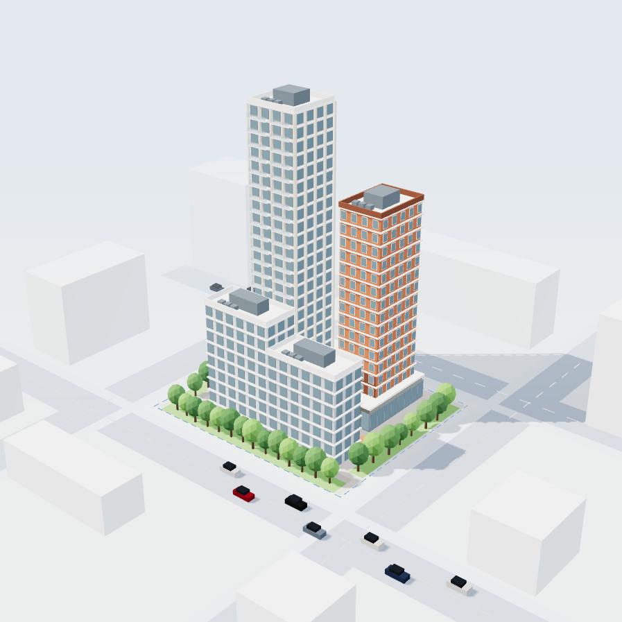
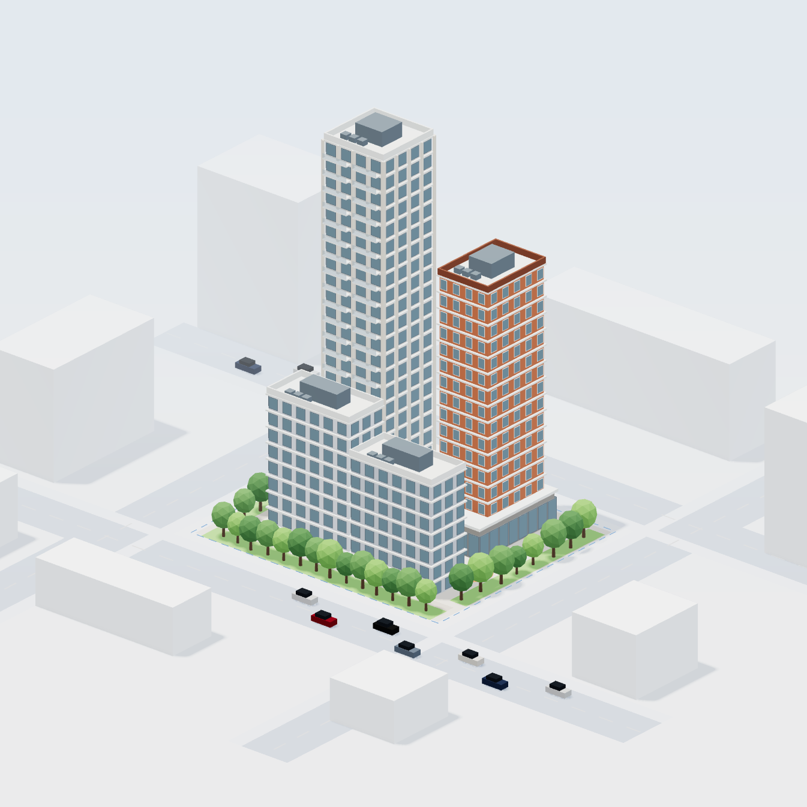
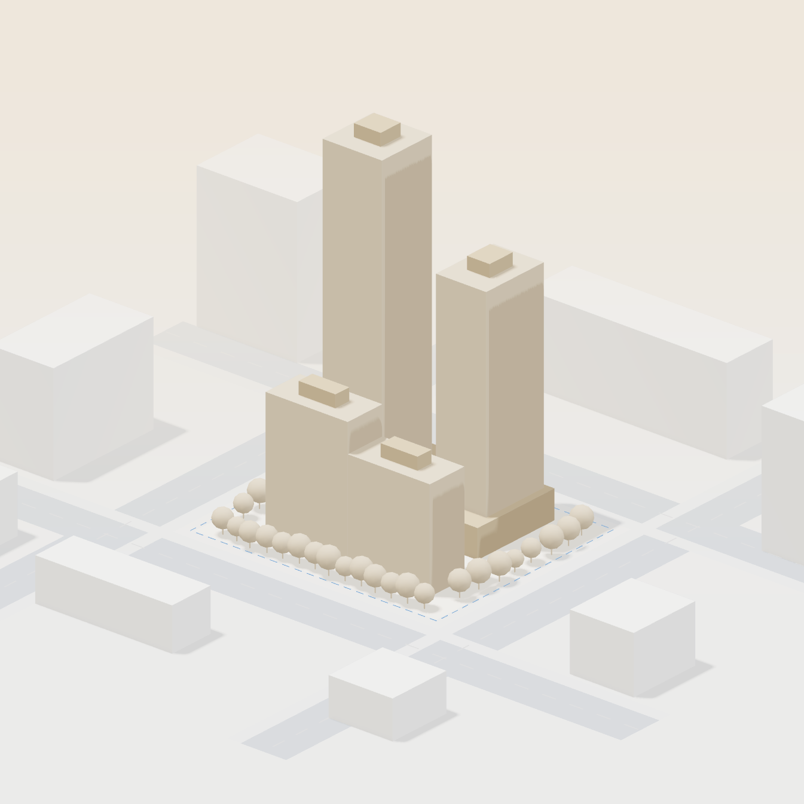
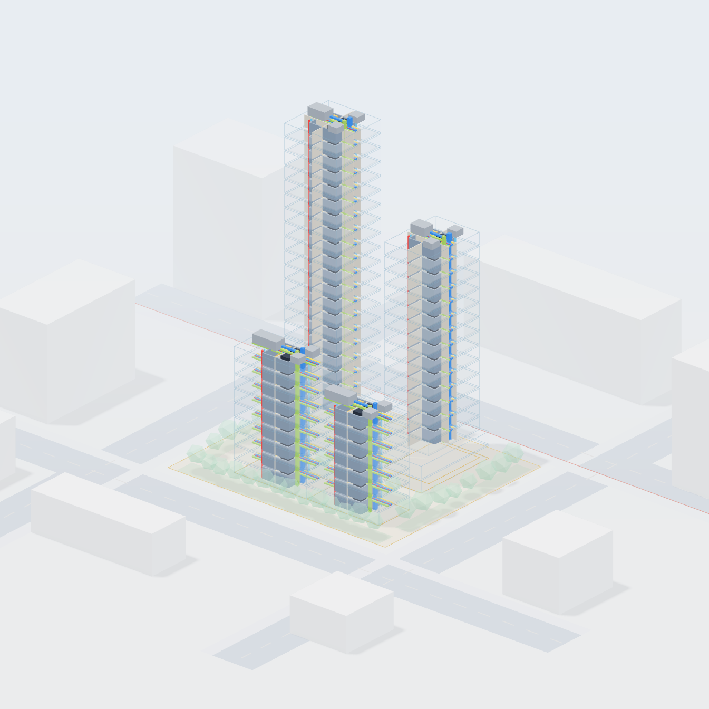
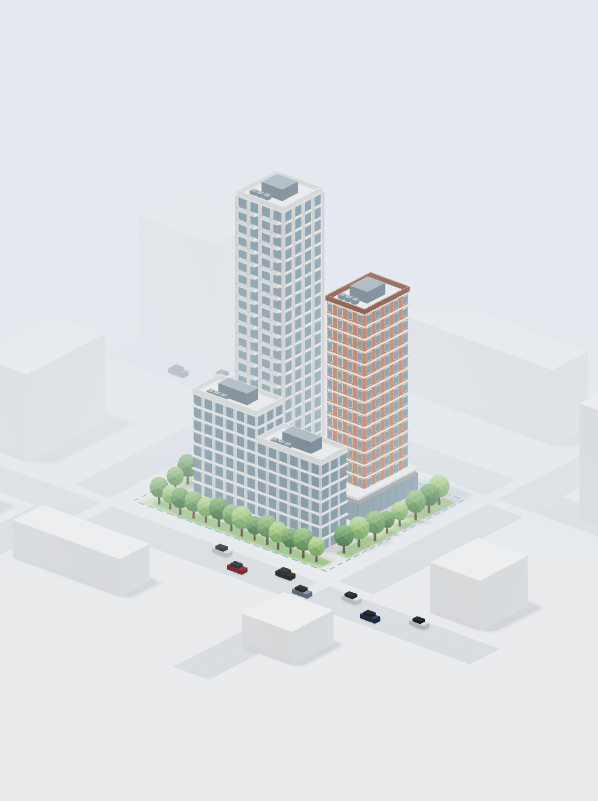
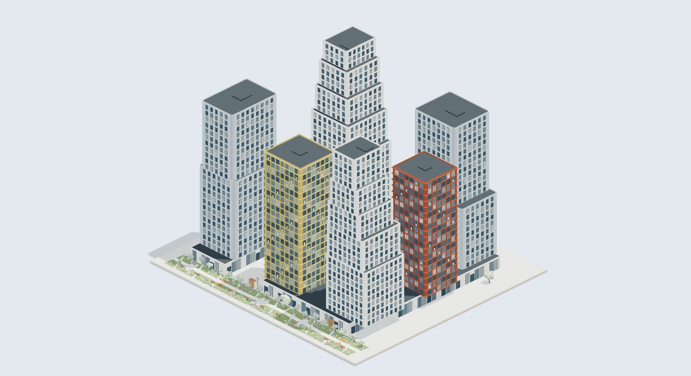
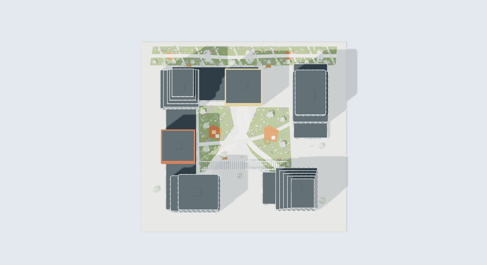
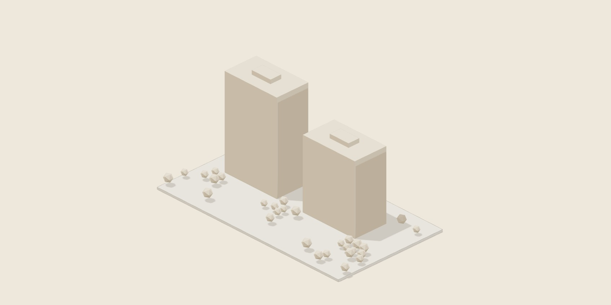
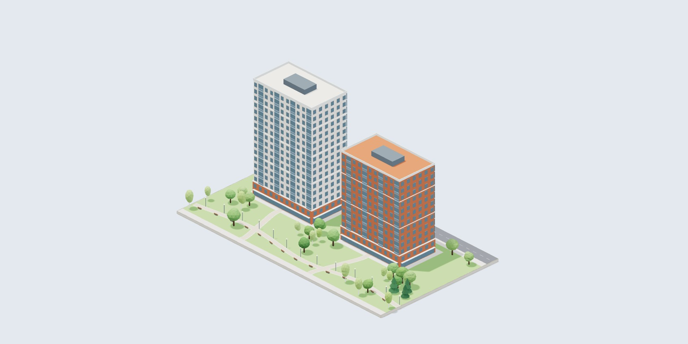
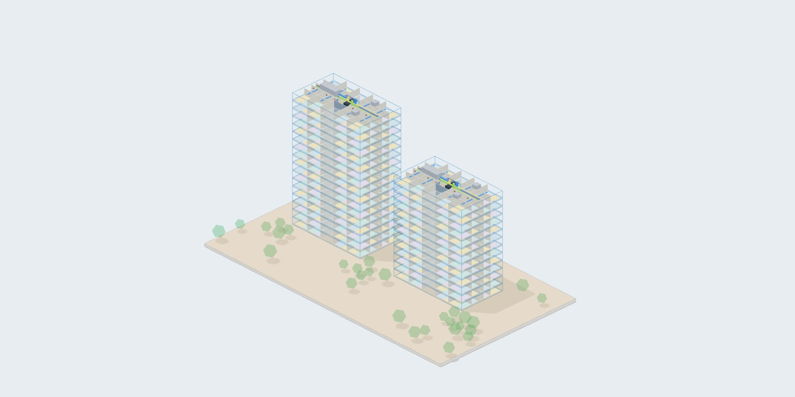

# Реальный браузерный результат

Изображения в этой папке получены из WebGL-буфера Three.js r128 в Chromium (ANGLE / SwiftShader), а не из Blender. Локальный предпросмотр использует исходные index.html, assets/gran-visual.js и assets/reference-project.js; внешние библиотеки и шрифты заменены локальными копиями тех же версий. Тестовая панель вызывает существующие renderer.render/snapshot и сохраняет PNG через сервер только на 127.0.0.1. Панели и обработчика сохранения в опубликованном коде нет.

## До и после

До: опубликованное дерево 8b28d8642cdefc62ae898268250bff16c7dce3d6 (в локальном checkout эквивалентно c985c4f). Для сравнимого ракурса автоматическое вращение остановлено только в тестовой копии. После: изменения этой ветки, общий renderer assets/gran-visual.js SHA-256 586eabc90349311ef293809bc1d7e67d0cd9d5042828e521a6646f4bab66b426.

| Прежняя ВПМ | Новая ВПМ |
| --- | --- |
|  |  |

Новый свет короче и мягче, фасадные рамки менее яркие, стекло спокойнее. Ортографическая камера сохраняет параллельность вертикалей. Повышено разрешение рендера при сохранении верхнего бюджета пикселей. Автовращение отключено: пользователь продолжает вращать интерактивные модели вручную.

## Главный макет

| НПМ 3 — тёплый камень | ЦИМ 1 — светлый технический |
| --- | --- |
|  |  |

## Узкий экран

Реальная страница также открыта в iframe с CSS-окном 390 × 844; проверены компоновка и приближение главного макета. Характеристики карточек при узкой ширине перенесены под изображение, чтобы не перекрывать фасад. Снимок ниже — его настоящий WebGL-буфер, без интерфейсных накладок. Это не проверка физического телефона или сенсорного ввода.

## Проект 1

Геометрия проекта не изменена этим исправлением. Это ориентировочная реконструкция шести корпусов по фотографиям. Точность 1 в 1 не подтверждена; требуются исходная 3D-модель или размерные чертежи.

## Калькулятор

| НПМ | ВПМ | ЦИМ |
| --- | --- | --- |
|  |  |  |

## Проверки и ограничения

- В браузере просмотрены главный макет в трёх режимах, все четыре карточки проектов, большой просмотр проекта 1, переключение на план сверху, калькулятор в трёх режимах и пересчёт 24 000 → 12 000 м²: 581 000 → 430 000 ₽.
- npm test: геометрия, объединение дорог, DOM, навигация, ВПМ-only проекты, границы расчёта стоимости, отсутствие WebGL, CPU-выбор этажей ЦИМ; дополнительно проверены ортографическое кадрирование, изменение пропорций и сброс масштаба для ракурсов. Эти тесты не доказывают визуальное качество.
- SwiftShader подтверждает настоящий WebGL-рендер и позволяет оценить изображение; скорость и поведение на физических телефонах и разных GPU не измерены.
- DevTools запрещены политикой браузера: консольные сообщения GPU не проверены. Страница и все приведённые изображения отрисованы без видимых сбоев.
- Публичный GitHub Pages в этой среде недоступен по сетевой политике. Новая публикация не выполнялась. Итоговую стилистику необходимо согласовать по этим браузерным кадрам.
